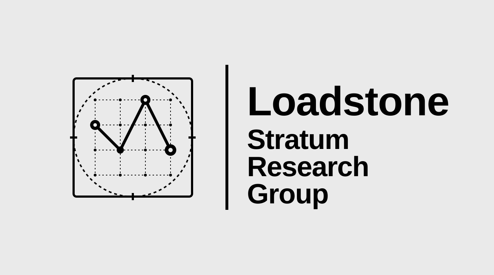

<p align="center">
  
</p>

Local-first benchmark harness for comparing trainable sequence-model
architectures under controlled training and evaluation conditions. It implements
[`loadstone-architecture-benchmark-spec-v0.1`](docs/spec-v0.1.txt), starting with
controlled MQAR.

The app owns tasks, splits, solvers, scorers, budgets and reports. Networks live
behind an adapter contract with declared capabilities; unsupported cells are
reported as unsupported and never as a zero score.

## Status

Milestone 1 (trustworthy MQAR runner) is implemented:

| Component | State |
|---|---|
| MQAR generator, oracle solver, scorer, held-out locking | done, Gate 0 tests |
| T0 baseline + candidate backbone with B0–B3 ablations | done, Gate 1 tests |
| Runner: training, validation checkpoints, budget, cancel/pause/resume | done |
| Artifact contract, SQLite index, report/CSV/SVG export | done |
| Smoke allocation + learning-plumbing gate | done (evidence under `studies/`) |
| S5, Rule110, decimal addition, enwik8 bytes, ACT sweep, desktop UI | **not implemented** (registered, refuses to substitute) |

## Quick start

```sh
uv venv --python 3.12 .venv
uv pip install --python .venv/bin/python torch --index-url https://download.pytorch.org/whl/cu128
uv pip install --python .venv/bin/python -e . --no-deps
uv pip install --python .venv/bin/python numpy pytest

loadstone data build --out data/mqar-v1 --per-cell 512   # lock held-out splits
loadstone plan --expand-jobs                              # capability matrix + 60-job matrix
loadstone validate --stage unit                           # Gate 0
loadstone validate --stage adapter                        # Gate 1
loadstone overfit --device cuda                           # Gate 2 learning plumbing
loadstone smoke --study smoke-1 --yes                     # 20-update plumbing run
loadstone report --study studies/smoke-1
```

A controlled study needs four explicit steps and refuses to skip any of them:

```sh
loadstone freeze --protocol protocols/mqar-v1.json --study mqar-study-1 --hours 30
loadstone approve --study studies/mqar-study-1 --yes        # prints the matrix first
loadstone run --frozen-protocol studies/mqar-study-1/protocol.resolved.json \
              --approval studies/mqar-study-1/approval.json
loadstone report --study studies/mqar-study-1 --format txt,csv,json
```

`pause` writes a control file that the runner observes between updates; `resume`
continues a job from a verified checkpoint, keeping spend and output caps.

## What the MQAR task is

256 symbols: `PAD=0`, `QUERY=1`, `END=2`, keys 3–66, values 67–130, distractors
131–255. An example of length `L` holds `K` key→value pairs at distinct even
positions in the first half, distractors everywhere else, and the last `2K`
positions are `QUERY, key` pairs. The gold value never appears in the input; the
score is cross entropy over 64 value classes at each query-key position, so
chance is exactly 1/64. Nine in-distribution cells (`L ∈ {128,256,512}` ×
`K ∈ {4,8,16}`) plus separate length-OOD cells.

## Identity

Logo, lockups, favicon and usage rules live in [`assets/logo/`](assets/logo/).
The mark is a lodestone: a stone with an induced field around it, one charged
facet, rust on graphite on paper. Regenerate with
`python assets/logo/build_assets.py`.

## Layout

```
src/loadstone/
  datasets/mqar.py        generator, oracle, held-out builder, training stream
  datasets/manifest.py    materialise + hash + verify split files
  scoring.py              pure scorers, aggregation, bits/byte
  models/blocks.py        RMSNorm, RoPE attention, SwiGLU, linear memory, loop block
  models/__init__.py      adapter contract, capabilities, size search, batching
  protocol.py             validate/resolve/expand/freeze/approve
  runner.py               training loop, telemetry, budget, checkpoints
  gates.py                Gate 2 learning-plumbing gate
  store.py                SQLite index (files stay self-describing)
  report.py               report.txt, tables/*.csv, charts/*.svg
  cli.py                  command surface
tests/                    Gate 0 (data/scorer) and Gate 1 (adapter mechanics)
docs/REVIEW.md            review of the specification, decisions and risks
studies/<study_id>/       protocol, approval, gates, jobs, tables, charts, report
```

## Documents

| File | What it is |
|---|---|
| [`docs/spec-v0.1.txt`](docs/spec-v0.1.txt) | the implementation contract this repo is built against |
| [`docs/REVIEW.md`](docs/REVIEW.md) | review of that spec: decisions taken, measured findings, risks |
| [`assets/logo/README.md`](assets/logo/README.md) | identity rules |

Licensed under the [MIT License](LICENSE).

## Non-goals

No model marketplace, agent framework, cloud fleet management, hosted
leaderboard, automatic purchasing, hyperparameter search beyond the frozen grid,
or training on test answers. Paid execution is prohibited in the MVP protocol.
