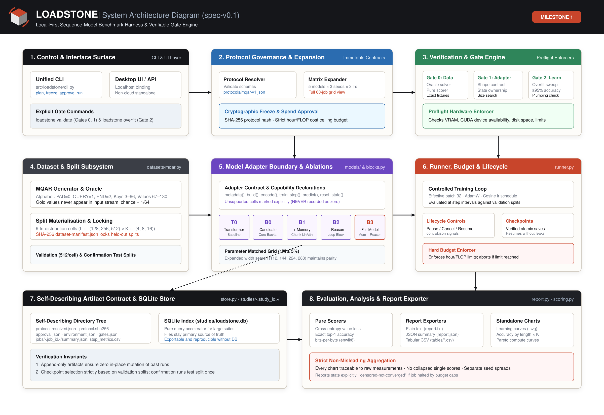
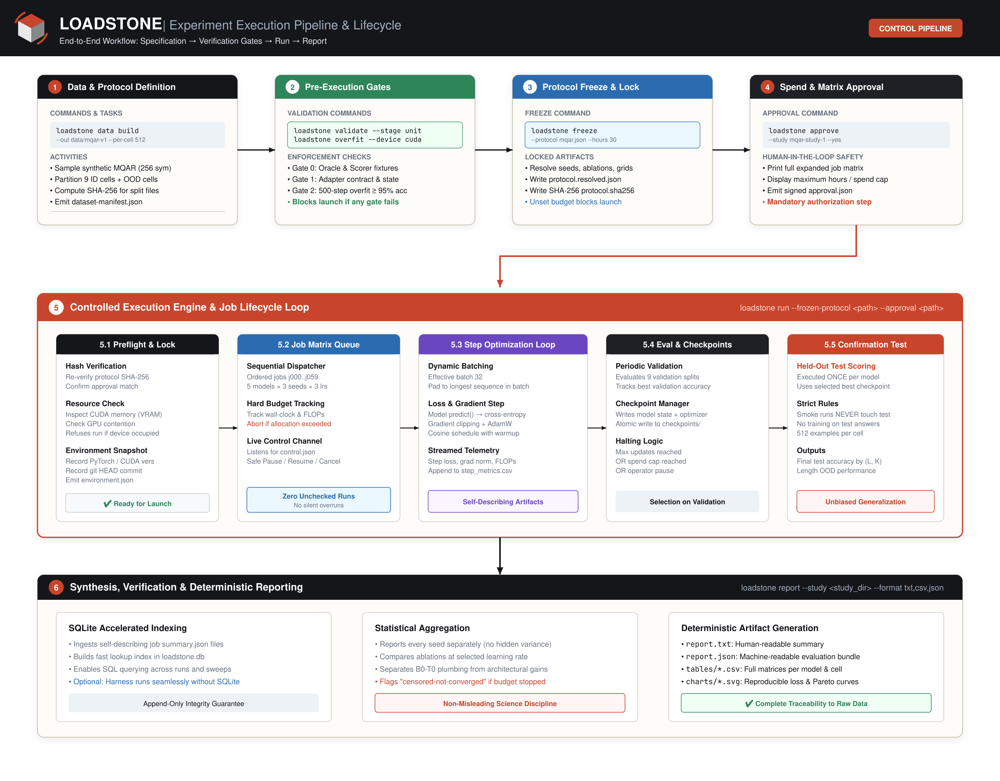

# Loadstone Architecture & Pipeline Diagrams

Visual specifications for the Loadstone sequence-model architecture benchmark harness and reproducible gate execution pipeline.

---

## 1. System Architecture

The Loadstone system is structured around explicit trust boundaries, non-misleading metrics, immutable protocol governance, and verifiable gates.



### Key Architectural Layers

1. **Control & Interface Surface (`cli.py`):**
   * Single unified entrypoint for planning, freezing, approving, running, and reporting.
   * Direct invocation of verification gates (`validate`, `overfit`).
2. **Protocol Governance & Matrix Expansion (`protocol.py`):**
   * Translates declarative protocol specs (`protocols/mqar-v1.json`) into concrete job matrices (e.g. 5 models × 3 seeds × 3 learning rates = 45–60 jobs).
   * Freezes specifications with strict spend/time caps and cryptographic SHA-256 hashes (`protocol.resolved.json`, `protocol.sha256`).
3. **Verification & Gate Engine (`gates.py`):**
   * **Gate 0:** Oracle solver correctness & scoring fixtures.
   * **Gate 1:** Model adapter contracts, parameter estimation, and state isolation.
   * **Gate 2:** Learning-plumbing gate (500-update overfit test requiring ≥95% accuracy before spending GPU hours).
4. **Dataset & Split Subsystem (`datasets/mqar.py`, `datasets/manifest.py`):**
   * MQAR generator with 256-symbol discrete alphabet (`PAD=0, QUERY=1, END=2`, keys 3–66, values 67–130, distractors 131–255).
   * 9 in-distribution cells (`L ∈ {128, 256, 512}` × `K ∈ {4, 8, 16}`) plus length-OOD partitions.
   * Materialized splits locked under `dataset-manifest.json` with SHA-256 digests.
5. **Model Adapters & Ablation Matrix (`models/`):**
   * Models live behind an explicit capability contract (`metadata`, `build`, `encode`, `train_step`, `predict`, `reset_state`).
   * Standardized ablation configurations: **T0** (Transformer baseline), **B0** (Candidate backbone), **B1** (+Memory), **B2** (+Reasoning), and **B3** (Full model: Memory + Reasoning).
   * Parameter-matched grid (1M ± 5%) with expanded candidate widths `{112, 144, 224, 288}`.
6. **Controlled Runner & Execution Loop (`runner.py`):**
   * Single active worker with strict hardware resource preflights (CUDA memory, GPU contention).
   * In-flight control channel (`control.json`) supporting atomic pause, resume, and cancellation.
   * Hard budget tracker enforcing cumulative time and FLOP limits.
7. **Append-Only Storage Contract (`store.py`, `studies/<study_id>/`):**
   * Self-describing file tree preserving complete provenance (`protocol.resolved.json`, `approval.json`, `environment.json`, `gates.json`, `jobs/<job_id>/step_metrics.csv`).
   * Optional SQLite index (`studies/loadstone.db`) for rapid querying; zero dependency on SQLite for reproduction or export.
8. **Deterministic Reporting & Analysis (`report.py`, `scoring.py`):**
   * Pure scoring routines emitting human-readable summaries (`report.txt`), JSON bundles (`report.json`), tabular summaries (`tables/*.csv`), and Pareto curves (`charts/*.svg`).
   * Non-misleading reporting: unsupported cells reported as `UNSUPPORTED` (never zero); budget-interrupted runs marked `censored-not-converged`.

---

## 2. Experiment Execution Pipeline & Lifecycle

Every experiment run follows a strict six-phase lifecycle designed to prevent accidental spending, parameter mismatch, or data leakage.



### The 6 Execution Phases

```
Data Build & Manifest ──► Preflight Verification ──► Protocol Freeze
         (Phase 1)                   (Phase 2)               (Phase 3)
                                                                 │
                                                                 ▼
Deterministic Report  ◄── Indexed Storage & DB   ◄── Run Matrix & Tests
         (Phase 6)                   (Phase 5)               (Phase 4)
```

1. **Phase 1: Data & Protocol Definition (`loadstone data build`)**
   * Generates synthetic MQAR instances across in-distribution and out-of-distribution cells.
   * Materializes held-out evaluation splits (512 per cell) and hashes each split into `dataset-manifest.json`.
2. **Phase 2: Pre-Execution Gates (`loadstone validate`, `loadstone overfit`)**
   * Executes unit and adapter contract checks (Gates 0 & 1).
   * Evaluates learning plumbing via 500-step overfit test across screening learning rates (`1e-4`, `3e-4`, `1e-3`).
   * Requires ≥95% accuracy before any multi-seed study can launch.
3. **Phase 3: Protocol Freeze & Lock (`loadstone freeze`)**
   * Resolves comparison regimes (structural, parameter-matched, compute-matched).
   * Fixes maximum runtime hours and FLOP caps.
   * Freezes `protocol.resolved.json` and computes immutable `protocol.sha256`.
4. **Phase 4: Spend & Matrix Approval (`loadstone approve`)**
   * Displays the complete expanded job matrix and maximum cumulative budget to the operator.
   * Requires explicit operator sign-off (`--yes`) to emit signed `approval.json`.
5. **Phase 5: Controlled Execution Engine (`loadstone run`)**
   * **5.1 Preflight & Environment:** Verifies protocol SHA-256 match, checks GPU VRAM availability, and writes `environment.json`.
   * **5.2 Queue & Scheduling:** Dispatches sequential jobs with continuous budget monitoring and live `control.json` signal listener.
   * **5.3 Step Optimization:** Dynamic batching (effective batch 32), AdamW, cosine decay, recording telemetry to `step_metrics.csv`.
   * **5.4 Validation & Checkpointing:** Periodically evaluates validation splits, saving atomic model checkpoints.
   * **5.5 Confirmation Test:** Evaluates best checkpoint against held-out test splits once per model (smoke runs never touch test splits).
6. **Phase 6: Synthesis & Deterministic Reporting (`loadstone report`)**
   * Syncs summary data to SQLite index.
   * Aggregates seed statistics, model ablations, and efficiency curves.
   * Emits `report.txt`, `report.json`, CSV tables, and SVG figures.

---

## 3. Regenerating Diagrams

To regenerate the diagrams from source:

```sh
python docs/build_diagrams.py
```

This updates both the vector SVGs (`architecture_diagram.svg`, `pipeline_diagram.svg`) and high-resolution raster PNGs (`architecture_diagram.png`, `pipeline_diagram.png`).
